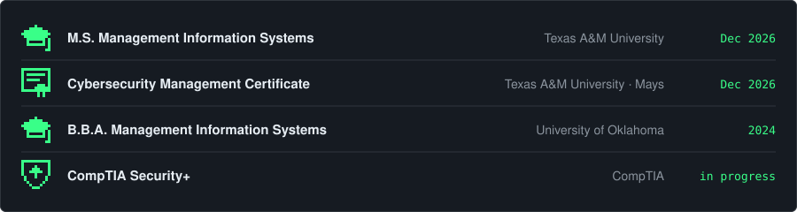
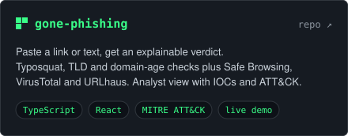
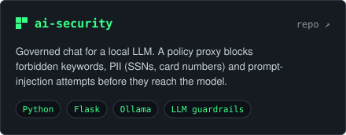
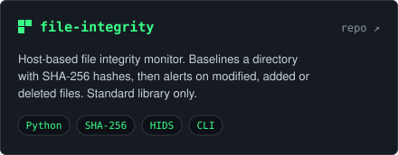
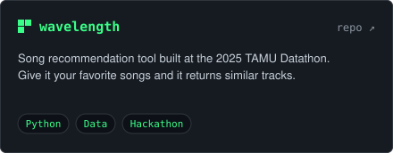

 

 

### `$ whoami`

Security-minded MIS grad student at **Texas A&M**. I build practical defensive tools: a phishing triage app with explainable verdicts, a policy proxy that guards a local LLM, and a host-based file integrity monitor.

 

### `$ git log --stat`

 

### `$ ls ~/projects`

 

### `$ cat skills.txt`

**security** &nbsp;·&nbsp; phishing analysis &nbsp;·&nbsp; IOC handling &nbsp;·&nbsp; MITRE ATT&CK &nbsp;·&nbsp; threat-intel APIs &nbsp;·&nbsp; file integrity monitoring &nbsp;·&nbsp; LLM guardrails &nbsp;·&nbsp; PII detection

 

`$ exit`

